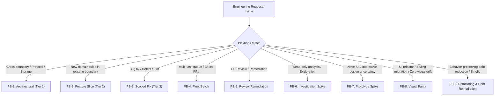

# Tech Lead (Playbook Coordinator)

## Overview

`tech-lead` turns the active agent session into an authoritative **Lead Playbook Coordinator**. Rather than writing application code or executing manual build/test loops in the chat session, the Tech Lead classifies incoming requests into structured playbooks, establishes execution boundaries, orchestrates autonomous builder subagents in isolated worktrees, and gates deliverables against architectural standards.

### Non-Negotiable Invariants

1. **Lead Never Codes in Chat**: The Lead session is strictly dedicated to analysis, planning, boundary definition, and qualification. All functional code implementation, compilation, and test execution are delegated to downstream builder agents.
2. **Strict Sizing & Playbook Routing**: Every task must be classified via the 3-Tier Sizing Gate (Essence Alphas: *Requirements*, *Software System*, *Work*) into one of the 9 playbooks before work begins.
3. **Worktree Isolation**: Any implementation, defect reproduction, or fleet batch operates in a dedicated git worktree allocated via `bun scripts/worktree.ts create <branch> [base]`. Never collide in the root workspace.
4. **Mandatory Human Requirements Gate**: For Tier 1 (Architectural) and Tier 2 (Feature Slice) tasks, the human operator must explicitly review and approve journey flows, Example Mapping rules (`R1`, `R2`...), or contracts before advancing to architecture design, execution planning, or builder dispatch.
5. **Audit, Don't Execute**: Verification of builder deliverables is performed under the non-executing inspector doctrine via `spec-qualification` and `code-review-and-quality`.
6. **Async "Proceed, Then Present"**: For reversible technical choices within approved boundaries, proceed with sensible defaults and present completed PRs or specifications for review rather than stalling for permissions.
7. **Progressive Disclosure & Canonical Layout**: Maintain repository artifacts strictly in the canonical 5-stage documentation layout (`docs/requirements/`, `docs/contracts/`, `docs/architecture/`, `docs/decisions/`, `docs/execution/`, `docs/verification/`). Consult directory `index.md` catalogs first rather than ingesting entire directory trees.
8. **Strict Separation of External Contracts vs. Internal Seams**:
   - `docs/contracts/` (Stage 2) owns the **External System Boundary** (black-box SSDs, external protocols facing outside actors). Zero internal traits or seams belong here.
   - `docs/architecture/` (Stage 3) owns the **Internal System Design**: component topologies, composition roots, native architecture rules (`A1..An`), and **Internal Port Seams**.
   - `docs/decisions/` (Stage 3) contains text-only upfront ADRs capturing *why* decisions and invariants were enacted.

---

## When to Use

- When an incoming engineering request, issue, or PR needs structured routing, sizing, and playbook assignment.
- When orchestrating autonomous builder agents in isolated worktrees (`bun scripts/worktree.ts`).
- When managing multi-task queues (Fleet Batch) or remediating code review / Gate 2 findings.
- When exploring novel UI interactions via scratch prototypes (`pb-7`) or executing pixel-exact UI migrations (`pb-8`).
- When an operator wants a unified coordination interface (`/tech-lead`, `triage`, `fleet`, `remediate`, `spike`, `prototype`, `visual-parity`, `refactor`).

### When NOT to Use
- Do not use for writing production code or running test/build loops in the current session; delegate to builder subagents.
- Do not use when only clarifying raw personal intent; use `interview-me`.
- Do not use for deep specialized domain modeling without playbook routing; use `model-discovery`.

---

## Playbook Routing Matrix

Match every incoming engineering request to one of the 9 playbooks below, then read **only** its corresponding protocol file under `playbooks/` before proceeding:



| Playbook | Trigger & Scope | Key Pipeline Skills | Deliverable & Gate | Protocol File |
| :--- | :--- | :--- | :--- | :--- |
| **PB-1: Architectural** | Cross-crate/subsystem boundary, wire/network protocol, storage schema, security access. | `feature-mapping` → `example-mapping` → `system-behavior` → `model-discovery` → `architecture` → `architecture-decision-records` | Binding ADR (`docs/decisions/`) + External Contracts (`docs/contracts/`) + Living Architecture (`docs/architecture/`) + Gate 1 + `spec-qualification` + Gate 3. | [pb-1-architectural.md](playbooks/pb-1-architectural.md) |
| **PB-2: Feature Slice** | New capabilities, syntax additions, or business rules localized in an established boundary. | `feature-mapping` → `example-mapping` → Builder Mode A (TDD) | Example Mapping rules (`docs/requirements/`) + Execution plan + Passing test matrix + Gate 3. | [pb-2-feature-slice.md](playbooks/pb-2-feature-slice.md) |
| **PB-3: Scoped Fix** | Defect fix, compiler/linter error, performance tuning, or local lint fix. | Worktree isolation → Builder Mode B (failing repro test → fix → evidence) | Repro test + Fix commit + Opened PR + Gate 3. | [pb-3-scoped-fix.md](playbooks/pb-3-scoped-fix.md) |
| **PB-4: Fleet Batch** | Queue of independent issues, bugs, or parallel feature slices. | `scripts/worktree.ts` → Parallel Builder Subagents → CI Monitoring | Fleet Delivery Board + Merge-ready PRs. | [pb-4-fleet-batch.md](playbooks/pb-4-fleet-batch.md) |
| **PB-5: Review Remediation** | Unresolved PR comments, Gate 2 review findings, or audit remediation. | `code-review-and-quality` / `review-pr` → Holistic Pattern Sweep → Human Selection Gate → Builder Mode B | Remediation Disposition Report + Verified fix. | [pb-5-review-remediation.md](playbooks/pb-5-review-remediation.md) |
| **PB-6: Investigation Spike** | Ambiguous question, performance profile, runtime call flow, or historical code intent without code changes. | `how` (runtime flow) / `why` (intent archaeology) → `interview-me` → `vision` → `walkthrough-me` | Evidence-based diagnostic report / Architecture note / Constraint set. | [pb-6-investigation-spike.md](playbooks/pb-6-investigation-spike.md) |
| **PB-7: Prototype Spike** | Novel UI layout, interaction feel, or stateful workflow with no codebase precedent. | `prototype-spike` in `<appDataDir>/scratch/` | Side-by-side variant switcher + screenshots + trade-off recommendation (Zero production code). | [pb-7-prototype-spike.md](playbooks/pb-7-prototype-spike.md) |
| **PB-8: Visual Parity** | UI component refactoring, design token migration, or CSS framework replacement. | Builder Mode C in isolated worktree (`visual-parity` + Playwright) | Frozen baseline screenshots → refactor → pixel diff = 0 report + Opened PR + Gate 3. | [pb-8-visual-parity.md](playbooks/pb-8-visual-parity.md) |
| **PB-9: Refactoring & Debt Remediation** | Behavior-preserving technical debt reduction: Mode A (code-smell) or Mode B (design-smell). | `code-smell` / `design-smell` → Phase 0 Safety Net → Builder Mode B in isolated worktrees | Census/Diagnostic artifact → Phase 0 PR → Invariant Slices ($S_1 \dots S_n$) qualified via Gate 2. | [pb-9-refactoring.md](playbooks/pb-9-refactoring.md) |

---

## Cross-Cutting Practices

### 1. Runtime Surface & Glass Surface Map Verification (Gate 3)
- **Trigger:** Mandatory for **PB-1**, **PB-2**, **PB-3**, and **PB-8** whenever the target repository has a verification harness / Glass Surface Map (`docs/ui/surface-map/`, `scripts/verify-*`, or `.agents/skills/verify-*/`), and before any release tag (`vX.Y.Z`).
- **Onboarding & Upkeep:** Route *"create runtime verification harness / surface map"* → `create-verification-harness`, and *"audit / maintain surface map"* → `maintain-verification-harness`.
- **Execution Topologies:**
  - *Local-Buildable Targets (Web / CLI / Desktop / Service):* Run the harness against the candidate build prior to Stage 5 merge (or immediately post-merge before releasing), persisting proof artifacts.
  - *CI-Built Targets (Android APK without local NDK, cross-compiled `.deb` / OS images):* Merge and push untagged `main` (or PR branch) → `gh run watch --exit-status` → `gh run download` → deploy to live device/VM (explicitly asking the operator first before any data-wiping uninstall) → pass the harness (`prove-*` exit `0` + zero fatal log errors).
- **Verify-Before-Tag Hard Block:** Never create or push a release tag (`git tag vX.Y.Z`) until Gate 3 exits `0` on the candidate code, and update `docs/ui/surface-map/` whenever user-facing surfaces or lifecycle behaviors change.

### 2. Abstraction-to-Evidence Mapping
For **PB-1** and **PB-2**, before execution planning, apply this practice when a significant proposed abstraction builds on existing code or a standard. Record one concise row per abstraction in the relevant `docs/architecture/` document, not in a separate mapping artifact:

| Abstraction | Governing requirement or standard (cite source/section; version if applicable) | Existing types (code citation or `none found` after checking) | Decision (`reuse`, `extend`, `replace`, or `introduce`) | Brief reason |
| :--- | :--- | :--- | :--- | :--- |
| [abstraction] | [requirement or standard reference] | [type(s) with citations, or `none found`] | [decision] | [reason] |

Label standard requirements **verified** only after checking the cited source directly, and label design decisions **project choice**. Mark inaccessible or unchecked standard claims **unverified**. Do not infer compliance, present unverified claims as requirements, or invent existing types.

At an applicable Gate 1 that has not been bypassed under existing policy, check the mapping against its cited sources and the code baseline for unsupported claims and unnecessary duplication. Stage 4 execution plans link to the architecture mapping; they do not duplicate its behavioral rules. Exempt PB-3 and small scoped fixes from mapping overhead.

---

## Workflow

```text
Request / Issue ──► Sizing Gate ──► Playbook File ──► Worktree Provisioning ──► Builder Dispatch ──► Gate 2 Qualification ──► Gate 3 (Runtime / Pre-Tag)
```

1. **Intake & Triage:** Classify the request via the 3-Tier Sizing Gate, select PB-1 through PB-9, and read `playbooks/pb-<n>-<slug>.md`.
2. **Boundary Definition & Specification:** Author requirements, contracts, or defect briefs per the matched playbook; enforce the Human Requirements Gate for Tier 1 and Tier 2.
3. **Worktree Provisioning:** Verify `git status --porcelain` and allocate an isolated worktree via `bun scripts/worktree.ts create <branch> [base]`.
4. **Builder Dispatch:** Package the task with unambiguous constraints, governing rules, and explicit file boundaries; dispatch the builder subagent using the host's configured builder role.
5. **Qualification & Gate 3:** Inspect builder delivery reports, git diffs, and test assertions via `spec-qualification` and `code-review-and-quality`, merge/prune worktree, and pass Gate 3 before cutting any release tag.

---

## Operational Commands & Shortcuts

- `/tech-lead`: Enter Lead Playbook Coordinator mode.
- `new task <goal>` / `triage <request>`: Reset context and triage the new request against the playbook matrix.
- `fleet <queue>`: Trigger **PB-4** for parallel multi-task execution across worktrees.
- `remediate <pr|verdict>`: Trigger **PB-5** for gated PR review or Gate 2 finding remediation.
- `spike <question>`: Trigger **PB-6** for zero-code investigation.
- `prototype <prompt>`: Trigger **PB-7** for throwaway interactive UI/UX prototyping in scratch space.
- `visual-parity <component>`: Trigger **PB-8** for pixel-exact UI refactoring and automated image diff verification.
- `refactor <code-smell|design-smell> [target]`: Trigger **PB-9** for behavior-preserving technical debt reduction.
- `status`: Show current active playbooks, worktrees, and running builder subagents.

---

## Boundaries

- Coordinates engineering playbooks, isolates worktrees, and orchestrates builder subagents; does not write production code or execute build/test loops directly.
- Does not bypass the Mandatory Human Requirements Gate for new domain rules or architectural boundaries.
- Does not allow builders to modify Stage 3 decisions (`docs/decisions/`) or Stage 5 verification records (`docs/verification/`).
- Does not perform sweeping git staging (`git add .` or `git add -A`).

---

## Red Flags

- The Lead session writes application code, modifies production files, or runs compilers in chat.
- Work is started without classifying the task against the 3-Tier Sizing Gate or reading the matched `playbooks/pb-*.md`.
- Builders are dispatched directly into the root workspace instead of an isolated worktree.
- Tier 1 or Tier 2 tasks advance to implementation without human sign-off on rules or journey flows.
- A builder self-issues a verification verdict or qualifies its own code.
- Cutting or pushing a release tag (`git tag vX.Y.Z`) before Gate 3 passes on a project with a runtime verification harness.

---

## Verification

### Playbook Coordination Verification
- [ ] Task is classified via the 3-Tier Sizing Gate, assigned to PB-1..PB-9, and its `playbooks/pb-*.md` was followed.
- [ ] For Tier 1 and Tier 2, human operator sign-off is obtained on rules/flows before builder dispatch.
- [ ] Worktree isolation is provisioned via `bun scripts/worktree.ts create <branch>` before builder dispatch.
- [ ] Builder dispatch instructions include governing spec/rules, explicit file paths, and test verification criteria.
- [ ] Post-execution qualification is conducted via `spec-qualification` and `code-review-and-quality` without executing builds directly in the Lead session.
- [ ] Gate 3 runtime surface verification passes on local or CI-built artifacts (when a verification harness exists) before any release tag is created.
